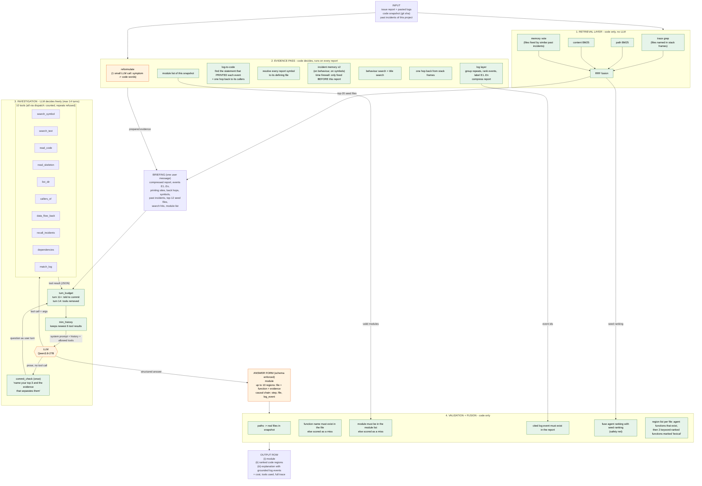

# 1. The free-loop agent (`--arm lc`)

The comparison arm. One model, ten tools, up to 14 turns, any order.

Green = code decides. Orange = the LLM decides.

# 2. The staged workflow (`--arm wf`, `agent/workflow.py`)

Same evidence pass and same final checks as the free loop. The free
investigation is replaced by fixed stages. Green = code decides. Orange = a
bounded model step with its own tools and a fixed answer form.

In plain words: code collects the clues, the model picks which files to
open, each file is judged alone with its code fully on screen, code walks
back from files that only report the failure, the model orders the files,
and code checks everything and builds the list of functions.

```mermaid
flowchart TD
    IN["INPUT<br/>issue report + logs, code snapshot, past incidents"]

    G["1 GATHER (code)<br/>clean the logs into events E1..En<br/>find the code that printed each event + its callers<br/>resolve report symbols, search by behaviour and title<br/>look up similar past incidents (fixed BEFORE this report)<br/>take the top-20 files of the retrieval ranking"]
    R["2 ROUTE (code)<br/>stack frames -> trace<br/>matched log lines -> logs<br/>else -> prose"]
    T["CANDIDATE TABLE (code)<br/>up to 30 files, each with WHY it is a candidate"]

    S{{"3 SHORTLIST (model, max 3 calls)<br/>MAY ASK: search_symbol, search_text,<br/>recall_incidents, match_log<br/>MUST ANSWER: up to 5 file paths + one reason"}}
    Q["QUEUE (code)<br/>keeps only picks that are in the table or the model's searches<br/>ADDS: top-2 retrieval files + the route's lead file"]

    FV["FILE VIEW (code), per file<br/>whole file if it fits ~6,000 tokens<br/>else whole functions, most relevant first, until full<br/>+ the list of every function name in the file"]
    E{{"4 EXAMINE, one file per step (model, max 3 calls)<br/>fresh context: report + this file only<br/>MAY ASK: read_code (other part of THIS file),<br/>callers_of, data_flow_back<br/>MUST ANSWER: role = cause / detects / unrelated,<br/>up to 3 functions from the list, quoted line, walk_back"}}
    C["VERDICT CARD (code)<br/>function names checked against the file;<br/>a name the file does not contain is dropped"]

    W["5 WALK BACK (code, once)<br/>for each 'detects' card: who calls that function?<br/>up to 2 caller files go back to EXAMINE"]

    K{{"6 RANK (model, no tools)<br/>sees the report and the cards, never raw code<br/>MUST ANSWER: order of the files, module, causal chain<br/>(each step names a log event id or none)"}}
    X["TIER RULE (code)<br/>cause before detects before unrelated;<br/>model's order kept inside each group"]

    P["7 BUILD REGIONS + CHECK (code)<br/>per file, in rank order:<br/>  card functions (2 for the first 3 files, 1 after)<br/>  then 2 keyword-ranked functions, marked 'lexical'<br/>module must be in the module list<br/>cited log event must exist in the report<br/>fill the file list from the retrieval ranking"]
    OUT["OUTPUT<br/>(i) module  (ii) ranked code regions  (iii) explanation<br/>+ every decision, cost and the full trace"]

    IN --> G
    G -- "evidence" --> R
    R -- "route" --> T
    T -- "table" --> S
    S -- "picked paths" --> Q
    Q -- "one file at a time" --> FV
    FV -- "code on screen" --> E
    E -- "verdict" --> C
    C -- "after the first pass" --> W
    W -- "new caller files" --> FV
    W -- "nothing to add" --> K
    C -- "after the second pass" --> K
    K -- "file order + explanation" --> X
    X --> P
    G -- "retrieval ranking, event ids, module list" --> P
    P --> OUT

    classDef code fill:#e6f4ea,stroke:#2e7d32,color:#000
    classDef llm fill:#fff3e0,stroke:#e65100,color:#000
    class IN,G,R,T,Q,FV,C,W,X,P,OUT code
    class S,E,K llm
```

## What each stage fixes (measured on the 26,541-instance main run)

| Stage | Problem in the free loop | Number |
|---|---|---|
| SHORTLIST, 2 search turns | keeps searching after the answer is in hand | a correct file is named on turn 1 in 82.8% of runs; turns 4-14 add 5.1 points |
| QUEUE, forced files | skips candidates it was given | 890 failures had the correct file in the seeds; 22.4% of them opened it |
| FILE VIEW | reads code through 80-line windows | 3.7 windows per file; in 32% of right-file-wrong-function runs the correct function was never on screen |
| EXAMINE, one file alone | ranks the file it read most and last | wrong top file was read later than the correct one in 67.7% of ordering failures |
| function list, up to 3 names | one function per file, some invented | 39.1% of those misses touch 2+ functions in the file |
| VERDICT CARDS into RANK | forgets what it read | a median 55.7% of tool output is gone at answer time |
| WALK BACK by code | never walks back by itself | callers_of used in 3.8% of runs |
| keyword functions after the agent's | short region list | region acc@5 0.607 -> 0.678 replayed on the main run, acc@1 unchanged |
